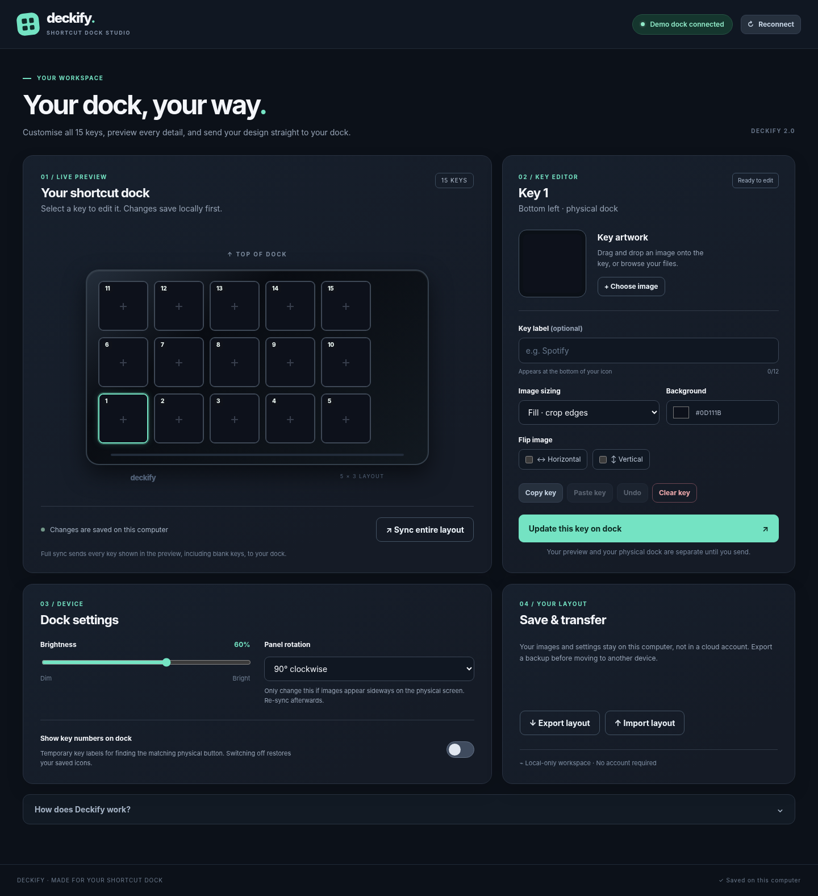

# Deckify 2.0

**A private, local icon studio for the Kmart Anko 15-key Shortcut Dock (USB `0100:1008`).**

*Deckify is an independent, unofficial companion project and is not affiliated with or endorsed by Kmart or Anko.*

Deckify lets you customise the images displayed on the dock's 15 keys. It is **not** a shortcut/action programming tool: image customisation does not change what the physical keys do. The UI runs in your browser, while a local Node.js process talks to the dock using USB HID. No account or cloud connection is required.



## Getting started

Requires **Node.js 20 or newer**. Use the latest stable LTS release. Windows is the primary target; macOS and Linux HID access have not been hardware-verified.

1. Connect the Anko Shortcut Dock to the computer.
2. **Close the official Shortcut Dock software**, including its background/tray process. Only one program can typically open the HID interface at a time.
3. Download/unzip this project and open the `deckify` folder.
4. On Windows, double-click **`start.bat`**. On macOS, run **`./start.command`** (or `bash start.command`). On Linux, run **`bash start.sh`**. These scripts install npm dependencies on the first run.
5. The UI opens at **http://localhost:4310**. Leave the terminal window open while using Deckify.

Manual launch:

```bash
npm install
npm start
```

Want to try it **without a dock or any npm install**? Use `npm run demo` (or `start-demo.bat` on Windows). Demo mode sends images to an in-process mock dock rather than physical hardware.

## Main features

- **Accurate 5 × 3 dock preview** in the dock's fixed native key order (top row 11–15; centre 6–10; bottom 1–5). The old confusing “Key numbering” selector was removed. Pressing a physical dock key selects it in the editor.
- **Key editor:** add PNG/JPG/WebP images by browsing or drag/drop, choose fill-or-fit, set background colour, add a label of up to 12 characters, and flip the image horizontally or vertically.
- **Copy / paste / undo:** quickly duplicate designs across keys and recover edits.
- **Save locally automatically:** preview edits save to `dock_layout.json`, and an on-screen indicator shows changes that have not been synced to the hardware this session.
- **Update this key:** sends only the selected key's design to the dock.
- **Sync entire layout:** sends **all 15** icons as shown, including blank keys. Use for initial setup, switching layouts, or restoring the dock.
- **Show key numbers on dock:** a genuine **on/off switch**. ON temporarily sends large identification numbers to each key; OFF sends the complete saved layout back. The switch never rewrites your saved icons.
- **Rotation correction and brightness** controls.
- **Import/export** portable `.json` layout backups, including embedded images.
- **Connection status, transfer progress, recoverable errors, responsive UI, and local security safeguards.**

> **Important:** Saving an icon in the browser does not update the physical dock automatically. Click **Update this key on dock** for a single key, or **Sync entire layout** to replace all 15 keys. A new session cannot know what is already on the dock; sync if the hardware and previews differ.

## Using a layout from Deckify 1.x

The older file `dock_layout.json` can be imported without losing the 15 saved images or flips:

1. Make a backup of the old file before upgrading.
2. Open Deckify 2.0, choose **Import layout**, and select the old JSON file.
3. Verify the preview (the old grid-numbering preference is intentionally removed).
4. Click **Sync entire layout** after connecting your dock.

Existing `dock_layout.json` files in the Deckify folder are also read automatically. On the first save Deckify removes obsolete settings but keeps the keyed artwork, captions and flips.

## Troubleshooting

| Symptom | What to try |
|---|---|
| **Dock disconnected** | Check the USB cable, close the official software, and click **Reconnect**. |
| **Port 4310 is occupied** | Close another running Deckify process or set `PORT=4311` in the terminal before launching. |
| **Images sideways** | Change **Panel rotation** and then **Sync entire layout**. The default is 90°. |
| **Hardware still shows identification numbers** | Reconnect, turn the switch off if it is on, or use **Sync entire layout**. |
| **Preview and dock disagree** | Remember that preview edits do not automatically send. Run a full sync. |
| **`node-hid` install fails** | Install an appropriate Node.js LTS version and the OS build/HID dependencies; see `PUBLISHING.md`. Try `npm run demo` to verify the UI independently. |

## Development and verification

```bash
npm test       # Node built-in tests: config, HID framing, API mock integration
npm run check  # Syntax checks + tests
npm run demo   # Real browser UI with mock hardware; no npm install needed
```

Actual USB hardware behaviour, including physical screen orientation and reconnect behaviour, **must be tested on your dock before a public release**. Mock tests cannot guarantee compatibility with every dock or operating system.

## Privacy and publishing

- Local web server binds to **127.0.0.1 only**, not your Wi-Fi/public interface.
- Each app run generates an in-memory API token for local requests.
- No analytics, accounts, remote image uploads or cloud sync.
- Images are embedded in `dock_layout.json`, which is **personal user data** and is excluded from published source packages via `.gitignore`.
- Exported `.json` layouts may contain personal images. Treat those backups as private unless you deliberately share them.
- This is a **locally hosted companion app, not a static website**. Hosting only `public/` on a web host will not provide USB access.

See `PRIVACY.md`, `PUBLISHING.md` and `CHANGELOG.md`. Source code is under the MIT license.
